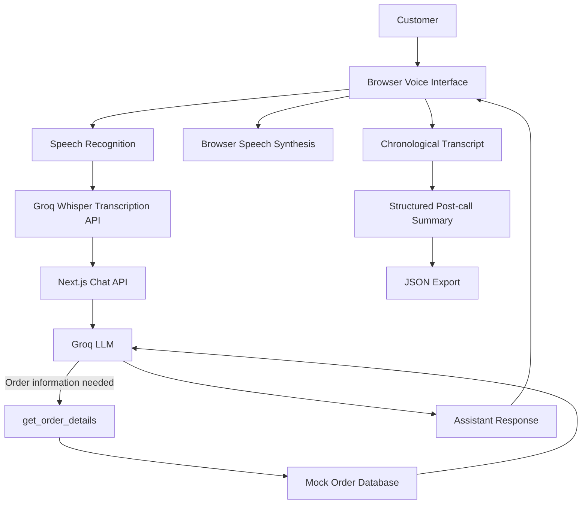

# Aura Skincare — AI Voice Customer Support Agent

An AI-powered voice customer support assistant built for Aura Skincare as part of the DataStraw AI Voice Agent hiring assignment.

**Aria** is a browser-based virtual support assistant that helps customers check order information, understand store policies and get concise answers through a voice-enabled conversational interface.

## Live Demo

- **Live Application:** [Live Demo](https://aura-voice-agent-delta.vercel.app)
- **GitHub Repository:** [Repository](https://github.com/Adarshsharma22/aura-voice-agent)
- **Demo Video:** [Video](https://drive.google.com/drive/folders/1fYoOuMs_Gexp2g9znuz0c0qd-o_GjoLU?usp=sharing)
- **Developer LinkedIn:** [My LinkedIn](https://www.linkedin.com/in/adarsh-sharma-03974430a)

## Overview

The goal of this project is to build a practical AI customer support experience that combines voice interaction, language-model reasoning, order lookup and policy-aware responses.

Customers can start a call, speak to Aria using their microphone, hear spoken responses, and review the conversation transcript and structured post-call summary.

The application uses mock order data to demonstrate how an AI support agent can retrieve verified information rather than inventing order details.

## Features

- **Voice-enabled interaction:** Speak to Aria through a browser-based interface.
- **Speech transcription:** Convert customer speech into text using Groq's Whisper transcription API.
- **AI-powered responses:** Generate relevant, concise answers using Groq-hosted language models.
- **Automatic listening:** In compatible browsers, the agent resumes listening after speaking.
- **Order lookup:** Retrieve mock order information using the `get_order_details(order_id)` tool.
- **Policy-aware responses:** Follow the configured shipping, return, cancellation, damage and payment policies.
- **Graceful error handling:** Handle missing or invalid order IDs and service errors.
- **Conversation transcript:** Display customer and assistant messages chronologically.
- **Post-call summary:** Show a structured summary of the conversation.
- **JSON export:** Export the transcript and structured summary for review.
- **Responsive interface:** Use the application on desktop and mobile-sized screens.

## Technology Stack

| Technology | Purpose |
|---|---|
| Next.js App Router | Frontend application and server-side API routes |
| React | Interactive UI and conversation state |
| JavaScript | Application logic |
| Tailwind CSS | Responsive styling |
| Lucide React | Interface icons |
| Groq API | Language-model inference and speech transcription |
| Llama 3.3 70B Versatile | Conversational reasoning and tool calling |
| Whisper Large V3 Turbo | Speech-to-text transcription |
| Browser Speech Recognition | Automatic speech input in compatible browsers |
| Browser Speech Synthesis | Spoken assistant responses |
| Vercel | Intended deployment platform |

*The implementation uses a modular speech pipeline rather than a direct speech-to-speech Realtime API.*

## Architecture



### Architecture components

**1. Browser interface**

The Next.js and React interface manages the call controls, microphone interaction, assistant status, messages, order examples and post-call summary.

**2. Speech input**

Browser speech recognition converts spoken input into text where supported. The application also provides a manual recording fallback that sends recorded audio to the transcription endpoint.

**3. AI processing**

The `/api/chat` route sends the customer's message and the configured assistant instructions to the Groq language model. The model can request the order lookup tool when an order-specific question requires verified information.

**4. Order lookup**

The `get_order_details(order_id)` function retrieves an order from the mock dataset. The result is passed back into the model so Aria can explain the actual status and available tracking details.

**5. Spoken output**

The application uses the browser's Speech Synthesis API to read Aria's response aloud. Listening is paused during speech and resumed afterward when the browser supports the required APIs.

**6. Post-call reporting**

The interface records customer and assistant messages with timestamps. When the call ends, it generates a rule-based summary and allows the user to export the transcript and summary as JSON.

## Project Structure

```text
aura-voice-agent/
├── app/
│   ├── api/
│   │   ├── ai-test/
│   │   │   └── route.js
│   │   ├── chat/
│   │   │   └── route.js
│   │   └── transcribe/
│   │       └── route.js
│   ├── globals.css
│   ├── layout.js
│   └── page.js
├── lib/
│   └── orders.js
├── public/
├── .env.example
├── .gitignore
├── package.json
└── README.md
```

*This structure reflects the implemented modules discussed during development. Adjust it if your repository has additional or differently named files.*

## How the Voice Pipeline Works

1. The customer clicks **Start Call**.
2. Aria greets the customer.
3. The browser begins automatic speech recognition when supported and permission has been granted.
4. The recognised customer message is sent to `/api/chat`.
5. The Groq language model generates a response and can request order lookup when necessary.
6. The application adds the response to the conversation transcript.
7. Browser speech synthesis reads the response aloud.
8. After the response finishes, the application resumes listening.
9. When the customer clicks **End Call**, the microphone and speech playback are stopped, and the post-call summary becomes available.

### Browser compatibility

Automatic voice interaction depends on browser speech recognition support and microphone permissions. Speech synthesis voices also vary by browser and operating system. The manual recording fallback can be used where automatic speech recognition is unavailable.

## How Tool Calling Works

The assistant has access to a function named `get_order_details(order_id)`.

When a customer asks a question such as:

> Where is my order ORD-101?

The model can request the order lookup tool. The server executes the function, retrieves the matching record and returns the result to the model. Aria then uses that data to formulate a customer-friendly response.

Order information is retrieved from the configured mock dataset rather than generated from the language model's memory.

The tool is intended to support:

- Valid order lookups.
- Missing order IDs.
- Invalid or unknown order IDs.
- Questions about whether an order is eligible for cancellation.

The application must not claim that an order was cancelled, refunded or otherwise changed unless that action is actually implemented.

## Mock Order Data

| Order ID | Customer | Product | Amount | Status |
|---|---|---|---:|---|
| ORD-101 | Priya Sharma | Vitamin C Serum (30ml) | ₹699 | Out for Delivery |
| ORD-102 | Rahul Verma | Hydrating Sunscreen SPF 50 | ₹499 | Delivered |
| ORD-103 | Ananya Patel | Green Tea Face Wash + Toner | ₹850 | Processing |

### Example order details

- **ORD-101:** BlueDart tracking number BD-982103; expected by 6 PM today.
- **ORD-102:** Delhivery tracking number DL-441029; delivered 14 days ago.
- **ORD-103:** Ordered three hours ago and still processing.

These are demonstration records, not live shipments.

## Brand Policies and Guardrails

Aria is instructed to answer according to the configured Aura Skincare policies.

| Policy | Rule |
|---|---|
| Shipping | Free for orders above ₹499; ₹50 shipping fee below ₹499 |
| Delivery | 3–5 business days |
| Returns | Within 7 days of delivery, for unopened and unused products in original packaging |
| Damaged or defective products | Report within 48 hours of delivery; photos are required for replacement requests |
| Cancellation | Only orders in Processing status are eligible |
| Shipped or Out for Delivery | Cannot be cancelled; the customer may refuse delivery at the doorstep |
| Cash on Delivery | Available for orders up to ₹2,500; cash or UPI |

Aria should politely refuse unrelated requests and ask customers to verify missing or invalid order IDs. She should not promise refunds, replacements or cancellations outside the configured rules.

## Setup and Installation

### Prerequisites

- Node.js and npm
- A Groq API key
- A modern browser with microphone support for voice testing
- Git

### 1. Clone the repository

```bash
git clone YOUR_GITHUB_REPOSITORY_URL
cd aura-voice-agent
```

Replace `YOUR_GITHUB_REPOSITORY_URL` with your actual repository URL.

### 2. Install dependencies

```bash
npm install
```

### 3. Configure environment variables

Create a `.env.local` file in the project root:

```env
GROQ_API_KEY=your_groq_api_key_here
```

Replace the placeholder with your own Groq API key.

Never commit `.env.local` or expose the API key in browser-side code.

### 4. Start the development server

```bash
npm run dev
```

Open:

```text
http://localhost:3000
```

Allow microphone access when prompted and test the conversation.

### Environment variables

| Variable | Required | Description |
|---|---|---|
| `GROQ_API_KEY` | Yes | Server-side key used to access Groq APIs |

Create a safe `.env.example` file containing:

```env
GROQ_API_KEY=your_groq_api_key_here
```

The example file must never contain a real API key.

## Testing

Use the following scenarios to validate the application before submission.

| Test | Example input | Expected behaviour |
|---|---|---|
| Greeting | "Hi Aria" | Friendly introduction |
| Shipping | "What are your shipping charges?" | Correct shipping fee and delivery estimate |
| Return policy | "Can I return an opened product after 20 days?" | Explain that the request is outside the return policy |
| Eligible cancellation | "Can I cancel ORD-103?" | Explain eligibility based on Processing status |
| Ineligible cancellation | "Can I cancel ORD-101?" | Explain that Out for Delivery orders cannot be cancelled |
| Order tracking | "Where is ORD-101?" | Return the configured BlueDart details and expected delivery |
| Delivered order | "What happened to ORD-102?" | Report Delivered status and the configured delivery information |
| Invalid order | "Where is ORD-999?" | Ask the customer to verify the order ID |
| Out-of-scope request | "Can you book a flight to Goa?" | Politely explain the assistant's scope |
| Unclear speech | Speak unclearly or mumble | Ask the customer to repeat the request |
| End call | Click End Call | Stop voice activity and display the post-call summary |

## Transcript and Structured Summary

The transcript records the conversation in chronological order, including customer and assistant messages with timestamps.

After the call ends, the interface presents a summary containing fields such as:

- Customer intent
- Order ID, when identified
- Last assistant response
- Customer and assistant message counts
- Follow-up indicator
- Call timestamps and duration

The JSON export includes the call information, transcript and structured summary.

**Current limitation:** The summary is rule-based rather than independently verified by a dedicated summarisation model. Intent classification and follow-up detection can be imperfect and should be reviewed before operational use.

## Deployment

The application is intended to be deployed on Vercel.

1. Push the completed code to GitHub.
2. Import the repository into Vercel.
3. Add `GROQ_API_KEY` under the project's environment variables.
4. Deploy the application.
5. Open the public URL and grant microphone permission.
6. Test order lookup, policy responses, automatic listening, End Call and JSON export on the deployed version.

After deployment, replace the Live Demo placeholder at the top of this README with the working public URL.

Do not assume the production build or deployed application is working until it has been tested.

## Security Considerations

- Keep the Groq API key on the server.
- Exclude `.env.local` from Git.
- Validate API request payloads and limit their size.
- Return safe error messages rather than leaking secrets or internal stack traces.
- Add rate limiting and abuse protection before public production use.
- Avoid retaining sensitive customer information unnecessarily.

The current order dataset is mock data and should not be treated as a production order-management system.

## Design Decisions

The project uses a modular speech pipeline:

**Speech recognition → transcription → language model and tool calling → spoken response.**

This approach was chosen because each stage can be tested independently, and the existing Next.js application can serve both the interface and API routes.

Browser speech synthesis avoids an additional server-side text-to-speech dependency, although voice quality and availability depend on the user's browser and operating system.

The mock order lookup separates verified order information from conversational reasoning. This reduces the risk of inventing shipment details and makes the implementation easier to demonstrate and test.

## Answering  Questions 

### 1. Why did you choose this architecture and technology stack?

I built this with Next.js and React so the customer interface and the API routes could live in one project. Tailwind CSS let me put together a responsive UI quickly. Groq handles the language model and transcription, and the browser’s built-in speech recognition and synthesis take care of voice input and output. I split everything into separate stages so I could test each one on its own, and the order lookup tool keeps real order data apart from whatever the model generates.

### 2. What was the most difficult part of the assignment, and how did you solve it?

The hardest part was getting the microphone, transcription, AI response and spoken output to feel like one conversation. I handled it by tracking the call state explicitly. Aria stops listening while she’s talking, new requests can’t overlap, and listening starts again after each reply. I also added a manual recording fallback, plus error handling for when mic permission is denied or transcription fails.

### 3. If you had one more week, what would you improve first and why?

First, I’d work on the voice experience. I’d move to a real-time voice pipeline with lower latency, so interruptions and turn detection work better. Next, I’d add more tests around policy enforcement, order lookup and failure cases. Last, I’d make the post-call summary more reliable, with structured outcomes a human can review.

### 4. What would need to change if the agent handled 1,000 customer conversations per day?

Before anything else, I’d measure how things behave under real use: concurrent calls, call length, transcription volume, response latency, provider limits and cost. Then I’d add rate limiting, timeouts, retries with backoff, structured logging and monitoring, and decide what happens when a provider goes down. Order data would move to a proper database, and anything that changes an order would need authentication and an audit trail. I’d also decide how to store transcripts, how long to keep them, and what privacy controls they need. Finally, I’d load-test the API routes to check whether the voice and language-model providers can keep up with the throughput and latency we’d need.

## Future Improvements

- Lower-latency, streaming voice responses.
- Better interruption and turn-taking handling.
- Improved support for Indian English and Hinglish.
- More robust automated tests for tool calling and policies.
- A dedicated summarisation step with validated structured output.
- Persistent storage for call records with appropriate privacy controls.
- Monitoring, rate limiting and operational alerts.
- Integration with a real order-management system.


## Approach Note

I built a browser-based AI customer support assistant using Next.js, Groq and browser voice APIs. The implementation combines speech transcription, language-model responses, mock order lookup and policy instructions, with a chronological transcript and a structured post-call summary. My focus was to create a practical, testable customer support experience while keeping the architecture understandable and straightforward to extend.

## Acknowledgements

This project was developed as part of the DataStraw AI Voice Agent hiring assignment for the fictional Aura Skincare brand.
